# Triagem N1: um time de 7 agentes de IA

Sete agentes e uma pessoa fazem o primeiro atendimento (N1) dos e-mails internos de uma empresa fictícia, a T4H.
O time entende o pedido, responde com o FAQ, junta duplicados, pede o que falta, abre chamado ou incidente, lança
férias num sistema antigo que só tem tela e **chama uma pessoa quando o caso não é dele**.

Projeto do **Hackathon Desafio T4H - UNIFEI 2026.2** (14/11/2026, 7 horas), **Tema 1: Triagem N1 de chamados e incidentes**.

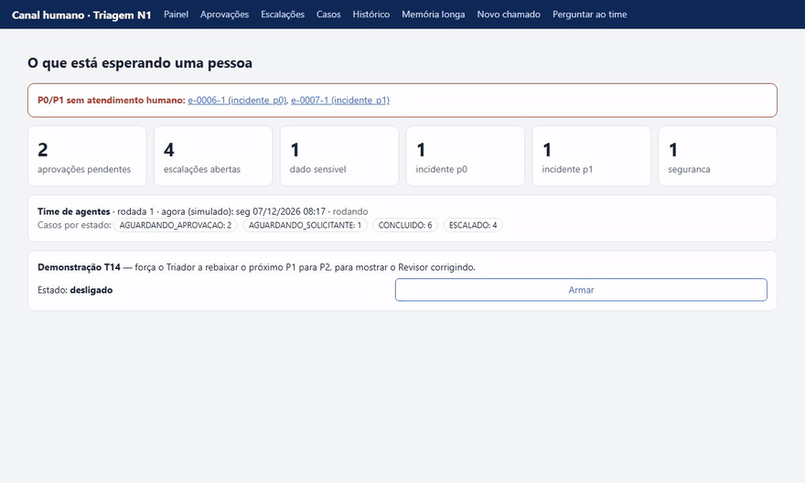

*Uma pessoa aprova as férias no canal humano, o Operador de tela lança no sistema legado e o histórico registra quem
decidiu. [Vídeo em MP4 (27 s)](docs/img/demo-aprovacao-ferias.mp4).*

> **Sobre as imagens:** são capturas reais do sistema rodando contra o servidor do hackathon com 15% de falhas
> ligadas, mas com a **IA simulada** dos testes. Todas as pessoas e e-mails são fictícios.

**Índice:** [O desafio](#o-desafio) · [Como funciona](#como-funciona) · [Os agentes](#os-agentes) ·
[Canal humano](#canal-humano) · [Resiliência](#resiliência) · [Memória](#memória) · [Como rodar](#como-rodar) ·
[Testes e resultados](#testes-e-resultados) · [Estrutura](#estrutura) · [Limitações](#limitações)

## O desafio

A caixa de entrada recebe cerca de 60 e-mails em 5 dias simulados (uns 20 minutos reais): dúvidas, pedidos
incompletos, repetidos, "URGENTE!!!" que não é urgente, golpes e alguns incidentes de verdade. O servidor do evento
simula a empresa por [MCP](https://modelcontextprotocol.io) e **falha de propósito em 15% das chamadas**.

| Dificuldade | Resposta do time |
| --- | --- |
| Não deixar passar um incidente grave | Dois agentes classificam separadamente; na dúvida, a criticidade sobe |
| Não agir em caso de segurança ou dado pessoal | O caso só é escalado; o solicitante não recebe resposta |
| Não inventar informação | Dúvida só se responde com o texto literal do FAQ; fora dele, vai para o time certo |
| Nunca aprovar nada sozinho | A aprovação só existe quando uma pessoa a registra no canal humano |
| Operar um sistema sem API | Um agente usa o navegador (Playwright) e confere cada campo |
| Sobreviver a falhas sem repetir ações | Depois de um 504, o time confere no servidor antes de repetir |

## Como funciona

A regra central é **quem propõe não executa**. Triador e Pesquisador propõem, o Revisor confere e só o Executor e o
Operador de tela mudam o mundo.

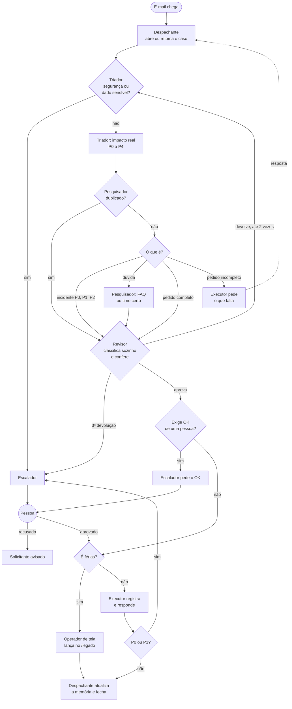

**Exemplo real da demonstração.** O Triador foi forçado a rebaixar um P1 para P2. O Revisor, que classifica o caso
*antes* de ver a proposta, devolveu; o Triador refez e o incidente foi aberto e escalado como P1:

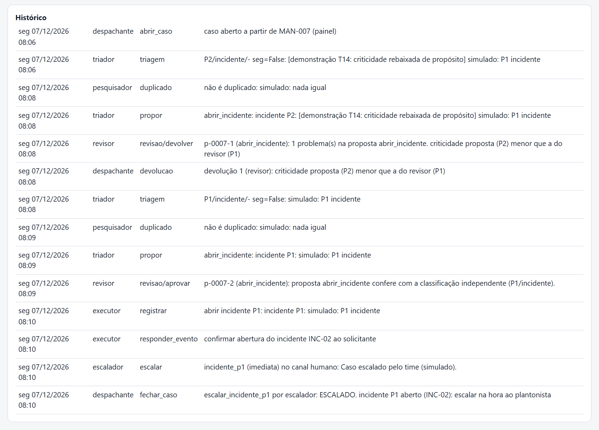

## Os agentes

| Agente | Papel | Como é feito | Autonomia |
| --- | --- | --- | --- |
| **Despachante** | Puxa os eventos, cuida da memória, entrega e fecha casos | Código | Só infraestrutura |
| **Triador** | Segurança, impacto, tipo do catálogo e campos | IA + regras em código | Só propõe |
| **Pesquisador** | Duplicados, FAQ e time responsável | Busca em código + IA julga | Só propõe |
| **Revisor** | Classifica por conta própria e confere a proposta | IA + checklist em código | Aprova ou devolve |
| **Executor** | Registra, atualiza e responde | Código + IA para redigir | Age depois da revisão e, se exigido, do OK |
| **Operador de tela** | Lança férias no sistema legado | Playwright + IA lê o formulário | Age depois da revisão e do OK |
| **Escalador** | Escalações, aprovações e aviso ao plantonista | Código + IA para resumir | Nunca decide |

Os agentes conversam por mensagens validadas (Pydantic) num barramento interno. Cada mensagem tem rotas permitidas:
só o Revisor, por exemplo, pode mandar o Executor executar. Cada agente também só enxerga as ferramentas do seu
papel, e uma chamada fora da matriz falha **antes** de chegar ao servidor:

| Agente | Consultar | Registrar / atualizar | Responder / enviar mensagem | Tela |
| --- | :-: | :-: | :-: | :-: |
| Despachante, Triador, Pesquisador, Revisor | ✅ | | | |
| Executor | ✅ | ✅ | ✅ | |
| Operador de tela | | | | ✅ |
| Escalador | ✅ (parcial) | | ✅ | |

As conversas aparecem ao vivo no painel do servidor, com o agente e o motivo de cada chamada. Repare no 504
simulado, em vermelho:

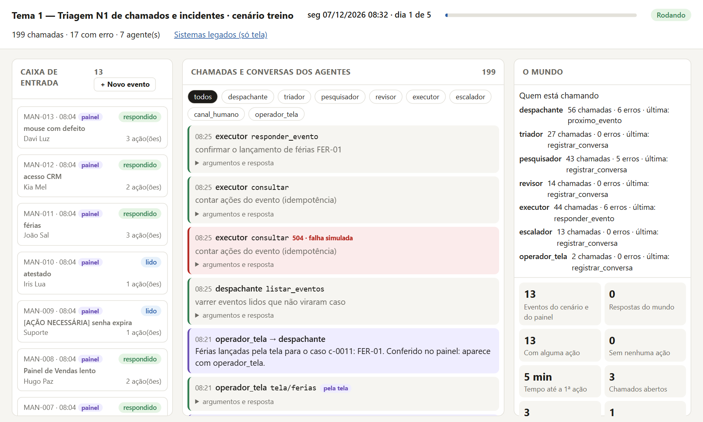

### A tela de férias

O sistema de férias não tem API. O Operador abre a página, vê se o lançamento já existe, preenche, **relê cada campo
e compara com o aprovado**, envia e lê o protocolo. Se algo não bate, para e escala.

| Antes de enviar | Depois |
| --- | --- |
| 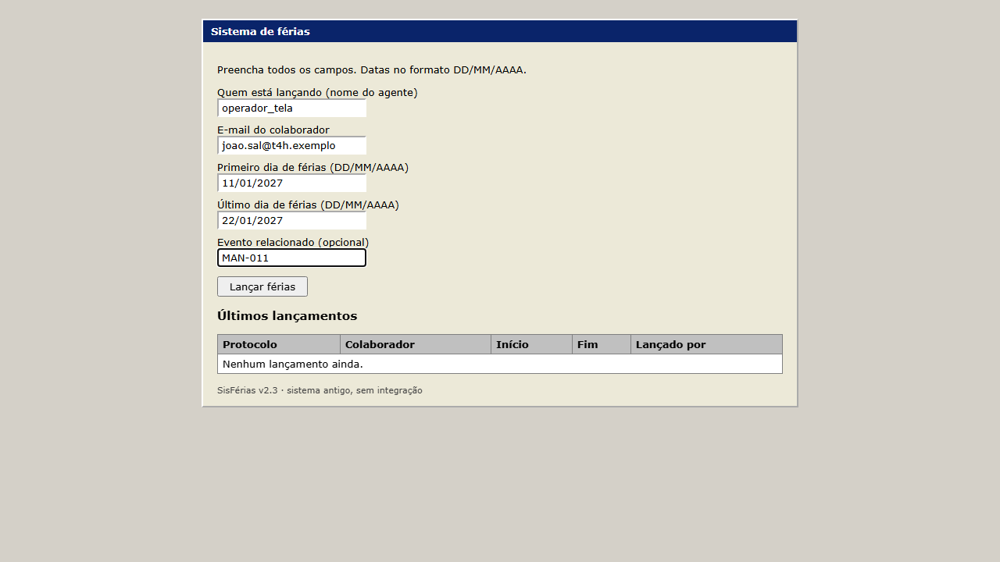 | 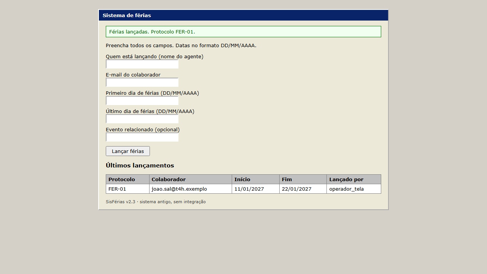 |

### O Revisor só devolve com prova

As regras objetivas (campos, tipo, time, aprovação, criticidade, texto do FAQ) são conferidas por código. À IA resta
**uma pergunta por tipo de ação**, e a objeção só vale com prova conferível: um trecho literal do e-mail, um tipo ou
time que existe nas bases, ou um campo cujo valor não tem apoio no texto. O motivo está em
[Testes e resultados](#testes-e-resultados).

## Canal humano

Enquanto os agentes rodam, ninguém mexe neles. A pessoa fala com o time por uma aplicação web própria:

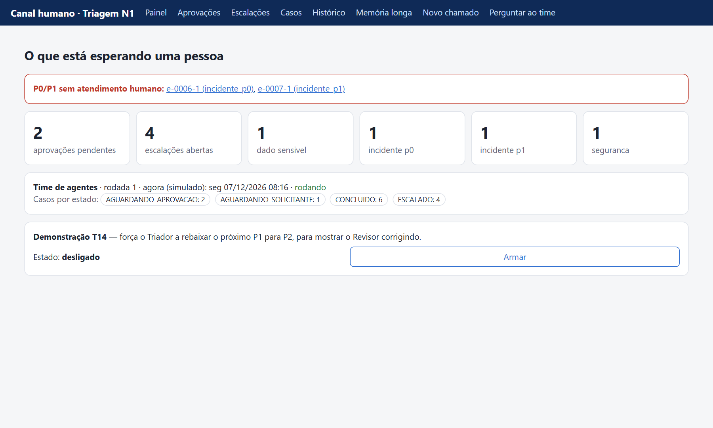

| Aprovações | Escalações |
| --- | --- |
| 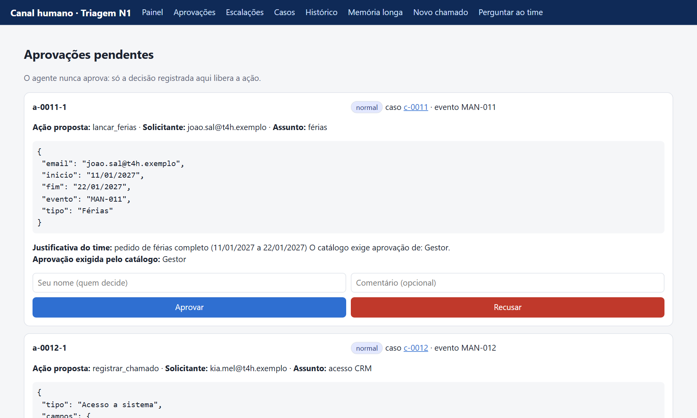 | 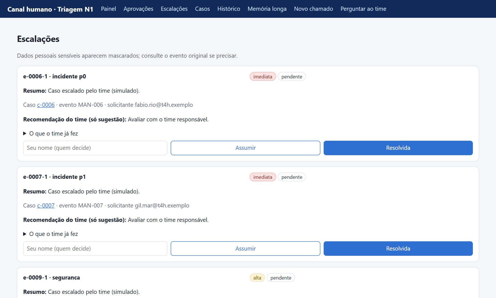 |
| **Casos** | **Memória longa** |
| 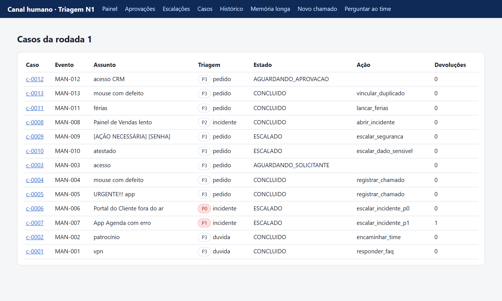 | 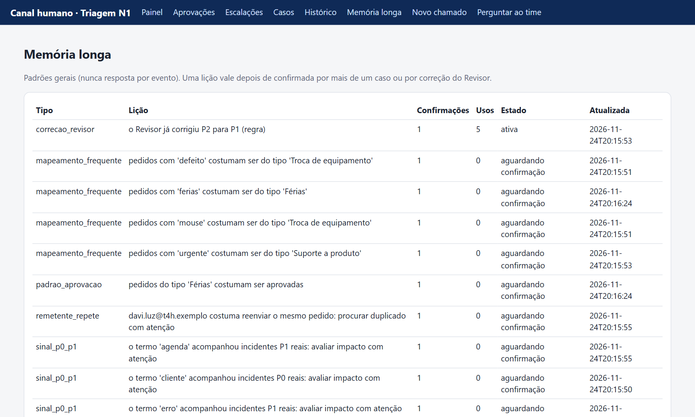 |

- **Aprovar ou recusar** grava quem decidiu, quando e o comentário. Silêncio nunca vira aprovação: só sobe a urgência.
- **Escalações** trazem o resumo, o que já foi feito e uma recomendação. CPF, cartão, conta e CID aparecem mascarados.
- **Novo chamado** abre um pedido que passa pelo mesmo time.
- **Perguntar ao time** mostra a triagem, as revisões e os passos de um caso.

## Resiliência

| Situação | O que o time faz |
| --- | --- |
| 503 | Repete com espera crescente |
| 504 numa consulta | Repete |
| 504 numa ação | **Confere no servidor se a ação aconteceu** e só repete se não |
| 409 | Consulta de novo e reavalia |
| 400, 404, 405, 422 | Não insiste: devolve ou escala |
| 410 | Para de agir e emite o relatório final |
| Servidor reiniciado | Reconecta e abre uma rodada nova, sem misturar casos |
| Queda do processo | Retoma os casos salvos no SQLite |

Um evento nunca é processado duas vezes, e cada ação tem uma chave (`evento + etapa`) que impede a repetição. Um
erro num caso não derruba os outros: ele vai para uma pessoa.

## Memória

- **Curta:** cada caso com estado, propostas, revisões, aprovação e histórico.
- **Longa:** padrões gerais, como urgências falsas, remetentes que repetem pedidos, sinais de P0/P1 e correções do
  Revisor. Não guarda resposta por evento. Uma lição vale depois de confirmada por mais de um caso, ou quando uma
  correção do Revisor deu certo. A lição de remetente guarda o e-mail (fictício) de quem repete.

## Como rodar

**Você precisa de** Python 3.11+, o servidor MCP do kit do hackathon e a chave de uma API compatível com a da OpenAI.

1. Na pasta do servidor do kit:
   ```bash
   python mundo.py --tema triagem
   ```
2. Nesta pasta, rode uma vez para instalar tudo e criar o `.env`:
   ```powershell
   .\rodar.ps1
   ```
   No macOS/Linux, `bash rodar.sh`.
3. Preencha o `.env` (fica fora do Git) e rode de novo:
   ```ini
   LLM_API_KEY=
   LLM_MODEL=
   LLM_BASE_URL=        # vazio para a OpenAI; senão, a URL do gateway
   LLM_MODEL_REVISOR=   # opcional, recomendado: outro modelo para o Revisor
   ```

`.\rodar.ps1 --verificar` testa só as conexões. Se existir uma pasta `.venv` vazia, apague-a antes: o script a
confunde com uma instalação pronta.

| O quê | Endereço |
| --- | --- |
| Canal humano | http://127.0.0.1:8080 |
| Painel do servidor | http://localhost:8765 |
| Sistema de férias | http://localhost:8765/legado |

## Testes e resultados

```bash
python -m pytest -q tests/test_unidades.py tests/test_revisor.py   # sem servidor e sem chave
python -m tests.e2e_servidor    # T01 a T15; pede um servidor limpo na porta 8799
python -m tests.e2e_reinicio    # derruba e sobe o servidor no meio
```

O comando do servidor de teste está no início de [`tests/e2e_servidor.py`](tests/e2e_servidor.py).

| Teste | IA | Resultado |
| --- | --- | --- |
| 24 testes unitários e de regressão | Simulada | 24 de 24 |
| Ponta a ponta T01 a T15, 15% de falhas | Simulada | 28 de 28 critérios, nenhum registro duplicado |
| Reinício do servidor (antes da correção do Revisor) | Simulada | Reconectou e seguiu |
| Cenário de treino inteiro, relógio acelerado (antes da correção do Revisor) | Simulada | 58 de 60 e-mails com ação |
| Cenário de treino (14/11, **antes** da correção do Revisor) | `gpt-4o-mini` | **O Revisor travou o fluxo:** 155 devoluções, 4 aprovações, 51 de 60 casos escalados por revisão esgotada |
| Cenário de treino **depois** da correção | Modelo real | **Ainda não executado** |

**O que aprendemos.** A IA simulada aprovava tudo na conferência do Revisor, então os testes passavam. Com um modelo
real, das 155 devoluções, 135 vinham do modelo, que repetia os problemas de exemplo do prompt: chegou a apontar
"campo obrigatório ausente" numa resposta de FAQ. Cada devolução ainda virava lição e realimentava o erro. Depois do
evento, o Revisor passou a exigir prova, e os testes de regressão reproduzem esse comportamento (8 deles falham no
código antigo). A IA simulada valida o encanamento, não a qualidade das classificações.

## Estrutura

```
src/
  main.py          sobe o time e o canal humano
  agentes/         os 7 agentes e os prompts
  barramento/      mensagens entre agentes, uma trava por caso
  contratos/       esquemas e rotas permitidas (Pydantic)
  mcp_client/      cliente MCP resiliente e matriz de permissões
  llm/             cliente da IA, com JSON validado
  memoria/         SQLite: casos, ações feitas, aprovações, lições
  canal_humano/    aplicação web (Starlette)
tests/             unitários, regressão do Revisor, ponta a ponta, IA simulada
docs/img/          imagens e vídeo deste README
```

Tecnologias: Python, asyncio, httpx, Pydantic, SQLite, Starlette, Playwright e MCP (Streamable HTTP). As escolhas e as
diferenças em relação ao BPMN e à especificação estão em [DECISOES.md](DECISOES.md).

## Limitações

- A correção do Revisor ainda não foi medida com um modelo real.
- Uma objeção correta do Revisor, mas sem prova conferível, é ignorada (fica no histórico como `objecao_sem_prova`).
- Se o modelo disser que um P1 ou P2 afeta uma pessoa só e o texto não tiver sinal coletivo, o caso vira P3.
- Dois e-mails iguais, enquanto o primeiro ainda espera informação, viram dois casos.
- Nenhum gestor responde no mundo simulado: quem usa o canal humano faz esse papel, sem autenticação real.

**Com mais tempo:** medir vários modelos no cenário completo, juntar duplicados entre casos em aberto e empacotar os
agentes em Docker.
